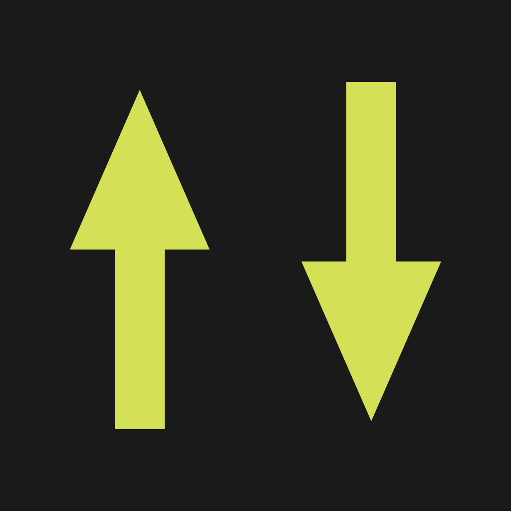
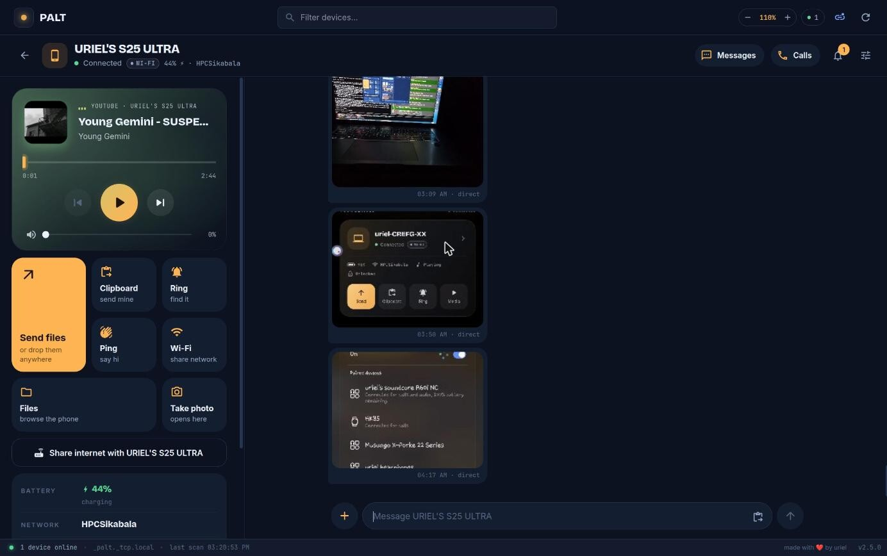
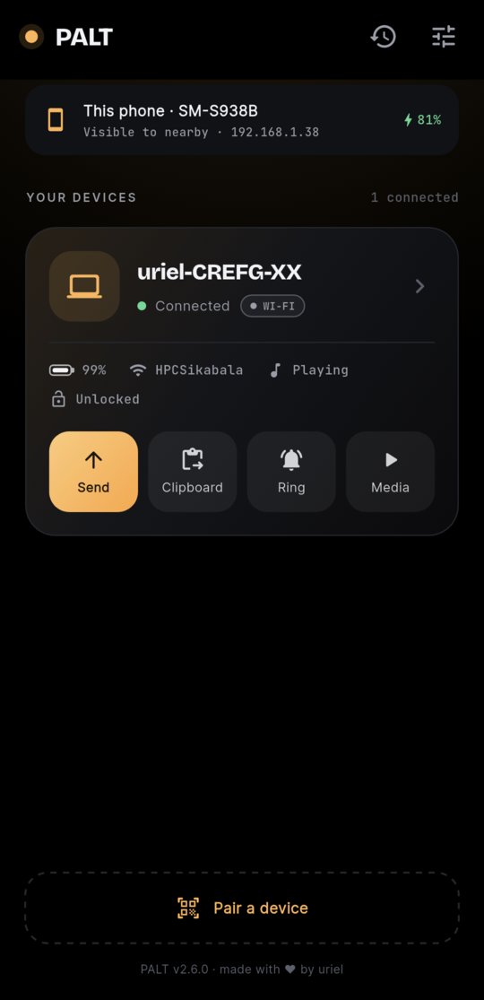
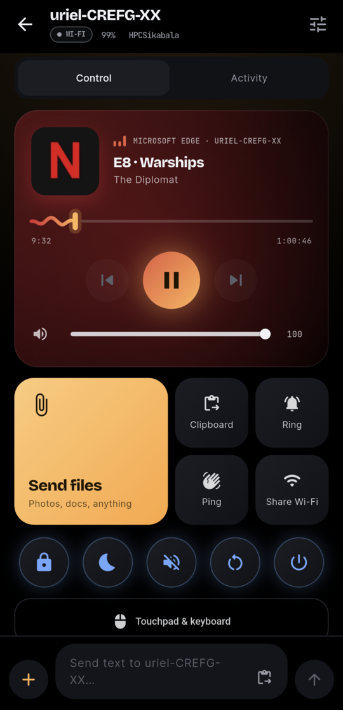
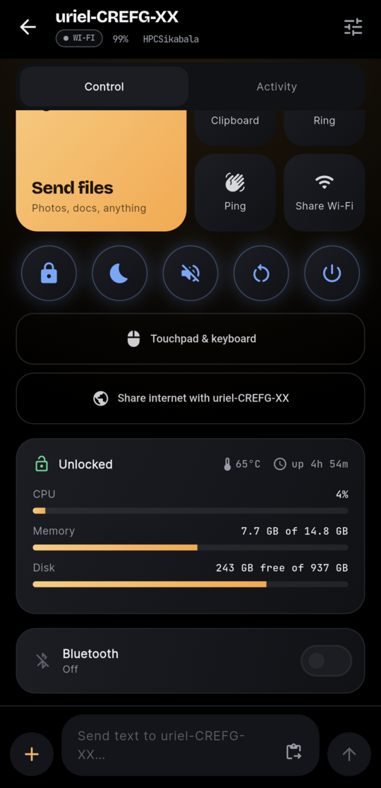
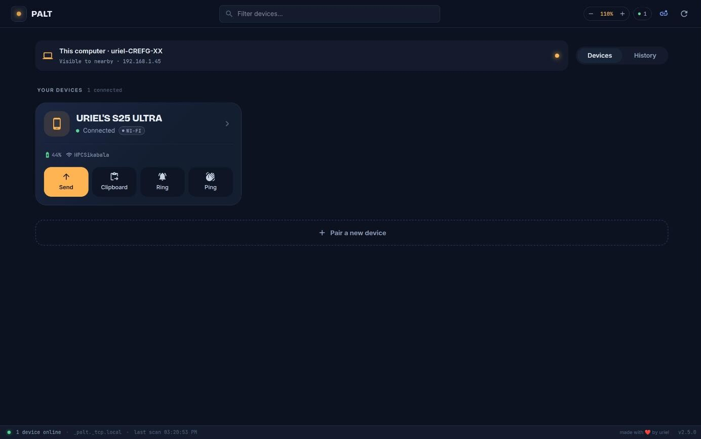

<div align="center">



# PALT

**Your phone and your laptop, finally on speaking terms.**

Send files, share the clipboard, answer texts and calls, control media, use the phone as a
touchpad, and unlock the laptop with your fingerprint. Everything runs over your own Wi-Fi or USB cable, with no cloud and no account.

[](https://github.com/h200137j/palt/releases/latest)
[](https://github.com/h200137j/palt/actions/workflows/release.yml)


[**Download**](https://github.com/h200137j/palt/releases/latest) · [Features](#features) · [Screenshots](#screenshots) · [Build](#building-from-source) · [Changelog](CHANGELOG.md)

<br/>



</div>

<br/>

## Why PALT

- **Local first.** Devices find each other over mDNS and talk point to point at full network speed. Nothing goes through a server.
- **Encrypted.** Pair once with a QR code. After that, every connection between paired devices is encrypted end to end.
- **Picks the fastest path.** USB cable, same Wi-Fi, or your own relay. PALT picks the fastest one and switches within seconds when the network changes.
- **More than file transfer.** It's like KDE Connect / GSConnect, with a design that is entirely its own.

<br/>

## Screenshots

<table>
  <tr>
    <td align="center" width="33%"><br/><sub><b>Your devices</b> at a glance</sub></td>
    <td align="center" width="33%"><br/><sub><b>Control</b>: now playing and quick actions</sub></td>
    <td align="center" width="33%"><br/><sub><b>Vitals</b>, Bluetooth and remote commands</sub></td>
  </tr>
</table>

<div align="center">
  
  <br/><sub>The desktop home screen: paired devices with battery, network and quick actions</sub>
</div>

<br/>

## Features

<table>
<tr>
<td valign="top" width="50%">

### 📁 Files & clipboard
- Drag & drop files onto a device, or use **Send with PALT** in the file manager
- Browse the phone's files from the laptop, with previews, upload, download and delete
- The phone's storage as a folder in the file manager's sidebar (`~/PALT/<phone>`)
- Clipboard sync both ways, including automatic copy from the phone
- Accept or decline every incoming transfer

### 💬 Messages & calls
- Read and send **SMS** from the laptop, with contacts
- One-time codes get a **Copy** button
- Call log, place calls, answer or decline from a live call bar
- Dual SIM support
- Media pauses automatically during calls

### 🔔 Notifications
- Phone notifications on the laptop, with reply and actions
- Choose per device what gets shared

</td>
<td valign="top" width="50%">

### 🎵 Media remote
- Control what's playing on either device, including volume
- The laptop's media shows up in Android's media controls
- Real Netflix titles through the [browser extension](browser-extension/)

### 🔐 Laptop control
- **Phone as touchpad & keyboard**: move, click, scroll, drag, and type with Ctrl, Alt, arrows and F-keys
- **Fingerprint unlock**: the lock screen, admin prompts and `sudo` ask the phone
- Lock, suspend, mute, restart, shut down, plus your own custom commands
- Proximity lock when the phone walks away
- Wake-on-LAN and keep-awake while the phone is connected

### 📡 Connectivity
- **USB tethering**: works with no Wi-Fi at all
- Share Wi-Fi in one tap, or join from a QR screenshot
- Share internet when one device goes offline
- Bluetooth status and toggle, both ways
- Battery, network, CPU, memory, disk and temperature

</td>
</tr>
</table>

<br/>

## Install

| Platform | Get it |
|---|---|
| 🐧 **Linux** (Debian / Ubuntu) | Download `palt-vX.Y.Z-linux-amd64.deb` from [Releases](https://github.com/h200137j/palt/releases/latest), then `sudo apt install ./palt-*.deb` |
| 🤖 **Android** | Download `palt-vX.Y.Z.apk` from [Releases](https://github.com/h200137j/palt/releases/latest) and install it |

Open PALT on both devices and scan the pairing QR code from the phone. PALT starts in the tray at login. Closing the window keeps it running; quit from the tray. Both apps check for updates and show what's new.

<details>
<summary><b>Remote use (optional relay)</b></summary>
<br/>

Not on the same network? Run your own [`palt-relay`](relay/) server and point PALT at it. Relayed transfers stay end-to-end encrypted and are never stored. When both devices are on the same network, PALT still connects directly. Each device and transfer is tagged **DIRECT** or **RELAY**.

</details>

<br/>

## How it works

```
 ┌────────────────────┐        mDNS  _palt._tcp.local         ┌────────────────────┐
 │  Linux desktop     │ ◄───────────────────────────────────► │  Android phone     │
 │  Go + Wails        │                                       │  Flutter           │
 │  React + MUI       │ ◄═══ encrypted TCP :9876 ═══════════► │  Riverpod          │
 └────────────────────┘    USB tether · Wi-Fi · relay         └────────────────────┘
```

| Part | Stack |
|---|---|
| Desktop | Go, [Wails v2](https://wails.io), React, MUI, Vite |
| Mobile | Flutter, Material 3, Riverpod |
| Discovery | ZeroConf / mDNS (`_palt._tcp.local.`), port `9876` |
| Relay | Small Go server ([`relay/`](relay/)), systemd unit included |

```
palt/
├── desktop/            # Wails app: Go backend + React frontend
│   ├── internal/       #   discovery, transfer, …
│   └── frontend/       #   Vite + React + MUI
├── mobile/             # Flutter Android app
├── relay/              # optional palt-relay server
├── browser-extension/  # Netflix "now playing" helper
└── .github/workflows/  # .deb + .apk release automation
```

<br/>

## Building from source

| Platform | Requirements |
|---|---|
| Desktop | Go ≥ 1.21, Node.js ≥ 18, [Wails v2 CLI](https://wails.io/docs/gettingstarted/installation/) |
| Linux deps | `sudo apt install libgtk-3-dev libwebkit2gtk-4.1-dev build-essential` |
| Mobile | Flutter SDK ≥ 3.19, Android SDK |

```bash
# Desktop
cd desktop
wails dev -tags webkit2_41                              # live reload
wails build -platform linux/amd64 -tags webkit2_41      # release binary

# Mobile
cd mobile
flutter pub get
flutter run
```

Releases are built by CI: pushing a `vX.Y.Z` tag builds the `.deb` and `.apk` and publishes them, using that version's section of [`CHANGELOG.md`](CHANGELOG.md) as the release notes.

<br/>

## Design

**Beacon**: a dark instrument panel with a signal-amber accent and mono data readouts.

<table>
<tr>
<td align="center"><br/><sub>Background</sub></td>
<td align="center"><br/><sub>Surface</sub></td>
<td align="center"><br/><sub>Hairline</sub></td>
<td align="center"><br/><sub>Accent</sub></td>
<td align="center"><br/><sub>Text</sub></td>
</tr>
</table>

Depth comes from surface steps and hairlines, not shadows. Each screen has one amber action. Values that come off the wire (IPs, speeds, sizes) are set in mono. Fonts: Bricolage Grotesque, Inter and JetBrains Mono. The full spec is in [`design.md`](design.md).

<details>
<summary><b>Technical notes</b></summary>
<br/>

**Android hostname.** Modern Android returns `localhost` for `Platform.localHostname`. PALT gets the real model name (e.g. *SM-S938B*) from `device_info_plus` and deduplicates peers by IP instead of by hostname.

**Touchpad & keyboard.** The laptop drives the pointer and keys through the xdg-desktop-portal RemoteDesktop portal, so it works on Wayland. GNOME asks once; PALT saves the restore token and later sessions start silently. The session closes when you leave the touchpad screen.

**Phone folder.** Each linked phone is mounted with FUSE (go-fuse, needs `fuse3`) at `~/PALT/<phone>`. Every file operation becomes a request over the encrypted link. Eject it from the sidebar, or turn it off in the phone's device settings on the laptop.

**Discovery lifecycle.** All peers broadcast on port `9876`. TXT records carry the OS (`linux`, `android`) so each device gets the right icon. Dead peers are removed by TTL (Go) or by `removeWhere` on multicast drop (Dart).

</details>

<br/>

<div align="center">
  <sub>Made with ❤️ by <a href="https://github.com/h200137j">uriel</a></sub>
</div>
